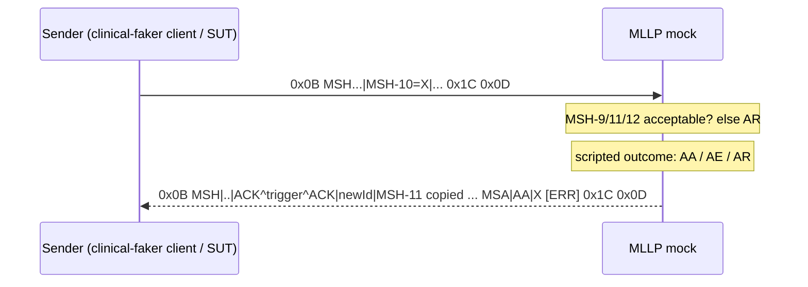

# MLLP mock server

Research for issue [#49](https://github.com/KingsleyBawuah/clinical-faker/issues/49) ("What must an MLLP mock server do?"), part of the MLLP mock server phase in [`docs/implementation.md`](../implementation.md). The questions:

1. What does MLLP require: framing bytes, ACK structure (`MSA`, `AA`/`AE`/`AR`), original vs. enhanced acknowledgment mode?
2. What do existing MLLP test tools offer (configurable NAKs, delays, message capture, client as well as server)?
3. Is `node:net` usable as-is on Node 22+ and Bun?
4. How should a `clinical-faker/mllp` subpath export be laid out so the root import stays browser-safe?

- **Sources:** primary sources where reachable, all fetched on **2026-10-21**. hl7.org's document center returned an empty `HTTP 202` (bot challenge) for every request, so the normative HL7 text comes from HL7's own v2+ rendering hosted by NIST and from the Caristix HL7 v2.5.1 definition API. Anything not confirmed against a primary source is marked **unverified**; design conclusions are marked *inferred*.
- **Target:** this library emits HL7 v2.5.1 (`src/hl7/version.ts`) and never values `MSH-15`/`MSH-16` (`src/hl7/segments/msh.ts`), so every generated message asks for **original-mode** acknowledgment.

## Summary

| Question | Answer |
| --- | --- |
| Framing | `<SB>` `0x0B` + HL7 payload + `<EB>` `0x1C` + `<CR>` `0x0D`. The end marker is the two-byte sequence `0x1C 0x0D`; a lone `0x0D` is a segment terminator. |
| Which MLLP release | v2 traffic uses MLLP Release 1 (the v2 lower-layer appendix). Release 2's transport-level commit ACK/NAK bytes are a v3-era addition, not something v2 senders expect (**unverified** against the normative R2 text). |
| ACK in original mode | `ACK^<trigger>^ACK` = `MSH`, `MSA`, optional `ERR`. `MSA-1` is `AA` (processed), `AE` (error), or `AR` (rejected: bad `MSH-9`/`MSH-11`/`MSH-12`, or system down). `MSA-2` echoes the inbound `MSH-10`. |
| ACK in enhanced mode | Triggered when `MSH-15`/`MSH-16` are valued. Accept ACK `CA`/`CE`/`CR` on the same connection; application ACK later as a *separate* exchange. Optional for a first mock. |
| Common tool features | Auto-ACK with selectable code, custom ACK override, message capture via handler/event, response timeout, client + server in one package, TLS, charset handling. Explicit "delay" knobs are rare; tools model it as a handler that awaits. |
| `node:net` | Stable on Node; "Fully implemented" on Bun. A probe server+client ran unchanged on Node v25.8.1 and Bun 1.4.0. Node 22 itself was not run locally. |
| Subpath layout | Add `"./mllp"` to `exports`; build both entries with `bun build --splitting`. A throwaway two-entry build confirmed only `dist/mllp/index.js` references `node:net`. |

## 1. MLLP framing

### Block format

HL7's v2+ rendering of the lower-layer-protocol appendix ([pages.nist.gov/v2plusDemo/lower-layer-protocol.html](https://pages.nist.gov/v2plusDemo/lower-layer-protocol.html), §4.2 "Block Format") defines the block as `<SB>dddd<EB><CR>`:

- `<SB>`: "Start Block character (1 byte) ASCII `<VT>`, i.e., `<0x0B>`. This should not be confused with the ASCII characters SOH or STX."
- `dddd`: "This is the HL7 data content of the block. The data can contain any displayable ASCII characters and the carriage return character, `<CR>`."
- `<EB>`: "End Block character (1 byte) ASCII `<FS>`, i.e., `<0x1C>`. This should not be confused with the ASCII characters ETX or EOT."
- `<CR>`: "The ASCII carriage return character, i.e., `<0x0D>`."

That page is a draft rendering of v2.9.1 ("This rendering does not reflect the final content found in version HL7 v2.9.1"). The v2.5.1 Appendix C text could not be fetched (hl7.org blocked). The block format has not changed across v2 releases (*inferred*; HAPI's `MinLowerLayerProtocol.java` cites "HL7 Implementation Guide, Appendix C" for the same bytes).

### What implementations do

- **HAPI HL7v2** (the Java reference implementation): `MllpConstants.java` defines `START_BYTE = 0x0b`, `END_BYTE1 = 0x1c`, `END_BYTE2 = 0x0d` ([source](https://github.com/hapifhir/hapi-hl7v2/blob/master/hapi-base/src/main/java/ca/uhn/hl7v2/llp/MllpConstants.java)). Its decoder state machine throws `"MLLP protocol violation - Stream ends in the message body"` or `"... before LLP end byte"` on a truncated frame ([MllpDecoderState.java](https://github.com/hapifhir/hapi-hl7v2/blob/master/hapi-base/src/main/java/ca/uhn/hl7v2/llp/MllpDecoderState.java)).
- **hl7v2-net** (`panates/hl7v2`, the same project as the `hl7v2` devDependency already used here): constants `VT = '\x0B'`, `FS = '\x1C'`, `CR = '\x0D'`, and a `FrameStream` that buffers partial chunks, extracts every complete frame from a chunk, and caps buffering with `maxBufferSize` ([constants.ts](https://github.com/panates/hl7v2/blob/main/packages/net/src/constants.ts), [frame-stream.ts](https://github.com/panates/hl7v2/blob/main/packages/net/src/helpers/frame-stream.ts)).
- **Apache Camel MLLP**: `requireEndOfData` (default `true`) controls whether the trailing `0x0D` is required, because "some systems" omit it ([camel.apache.org](https://camel.apache.org/components/next/mllp-component.html)). A lenient-framing option is worth considering for the mock's parser.

### Character encoding

HAPI's `MinLowerLayerProtocol.java` Javadoc: "MLLP supports all single-byte character encodings (e.g. iso-8859-x, cp1252) as well as UTF-8 and Shift_JIS. The byte values used by UTF-8 do not conflict with the byte values used for MLLP framing." UTF-16/UTF-32 "are therefore not supported by MLLP" ([source](https://github.com/hapifhir/hapi-hl7v2/blob/master/hapi-base/src/main/java/ca/uhn/hl7v2/llp/MinLowerLayerProtocol.java)). Camel defaults to ISO-8859-1 when neither `charsetName` nor `MSH-18` is set. **Implication:** frame and parse on `Buffer` bytes, never on decoded strings, and encode UTF-8 by default (*inferred*).

### Stream reassembly is the mock's job

TCP delivers a byte stream, not messages. Node's `'data'` event just hands over "a `Buffer` or `String`" ([nodejs.org/api/net.html](https://nodejs.org/api/net.html)) with no message boundaries. The local probe (below) wrote one frame split at byte 7, then the rest of it coalesced with a second frame in one `write`. A buffer-and-scan parser recovered both messages on Node and Bun. The mock must handle both splits and coalescing.

### Connection lifecycle

The appendix's pseudo-code (§6.1 "Initiating Module", §6.2 "Accepting Modules") is a persistent connection: the initiator loops `send(next message)` then `receive(reply)` until done, and the acceptor loops `receive(message)` → `application_code` → `send(reply)` until disconnected. So the mock should keep a connection open across many messages and reply one ACK per message, in order ([source](https://pages.nist.gov/v2plusDemo/lower-layer-protocol.html)).

### MLLP Release 2 (commit acknowledgment)

HL7 V3 "Transport Specification: MLLP, Release 2" (ANSI/HL7 V3 TRMLLP, R2-2006 (R2019)) adds transport-level commit ACK/NAK blocks. The secondary sources say these are `<SB><ACK 0x06><EB><CR>` and `<SB><NAK 0x15><EB><CR>` ([mllp-rs docs](https://docs.rs/mllp-rs)). The HL7 page itself ([hl7.org](http://www.hl7.org/documentcenter/private/standards/v3/edition_web/infrastructure/transport/transport_mllp.html)) could not be fetched, so the byte values and its current status (the [product brief](https://www.hl7.org/implement/standards/product_brief.cfm?product_id=55) is reported to list a withdrawal) are **unverified**. None of the v2 tools surveyed implements R2 commit bytes. **Recommendation:** out of scope for the mock.

## 2. Acknowledgment rules (HL7 v2 Chapter 2)

Narrative rules: HL7 v2+ Control chapter, "Message Processing Rules" ([pages.nist.gov/v2plusDemo/domain/Control.html](https://pages.nist.gov/v2plusDemo/domain/Control.html)), a v2.9.1 draft rendering. Field and table definitions: the Caristix HL7 v2.5.1 definition API (`hl7-definition.caristix.com/v2-api/1/HL7v2.5.1/...`), cited per item below.

### Which mode applies

- "The user MAY use either the original processing rules ... or the enhanced processing rules". Original mode applies when "Both MSH-15 - accept acknowledgment type and MSH-16 - application acknowledgment type are not present." Enhanced mode: "Both MSH-15 ... and MSH-16 ... SHALL BE valued." ([Control](https://pages.nist.gov/v2plusDemo/domain/Control.html))
- In v2.5.1, `MSH-15` and `MSH-16` are optional `ID` fields on table 0155: `AL` Always, `ER` Error/reject conditions only, `NE` Never, `SU` Successful completion only ([MSH](https://hl7-definition.caristix.com/v2-api/1/HL7v2.5.1/Segments/MSH), [0155](https://hl7-definition.caristix.com/v2-api/1/HL7v2.5.1/Tables/0155)).
- clinical-faker never sets `MSH-15`/`MSH-16`, so its own messages always get original mode. A mock that also receives third-party messages should branch on these fields.

### Original mode (the must-have)

From the Control chapter ([source](https://pages.nist.gov/v2plusDemo/domain/Control.html)):

- **Protocol validation first:** the responder checks that `MSH-9` (message type), `MSH-12` (version), and `MSH-11` (processing ID) are acceptable. "If any of these edits fail, the protocol software rejects the message. That is, it creates an ACK message with AR in MSA-1."
- **Then the application:** `AA` when processed successfully. `AE` for an "error response, providing error information". `AR` when it fails "for reasons unrelated to its content or format (system down, internal error, etc.)".
- "If the Acknowledgment Code is other than AA, the reason(s) for the rejection SHOULD be sent in the ERR segment(s)."
- **Response `MSH`:** "constructed anew". "`MSH-7` ... and `MSH-10` ... refer to the response message; they are not echoes of the fields in the initial message." "`MSH-5`, `MSH-6`, and `MSH-11` contain codes that are copied from `MSH-3`, `MSH-4` and `MSH-11` in the initiating message."
- **`MSA`:** `MSA-1` is the code above, `MSA-2` is the inbound `MSH-10`, and `MSA-4` is used only with the sequence-number protocol.

v2.5.1 structures:

- **ACK message** ([ACK](https://hl7-definition.caristix.com/v2-api/1/HL7v2.5.1/TriggerEvents/ACK)): `MSH` (R), `[{SFT}]`, `MSA` (R), `[{ERR}]`. "The value of MSH-9-2-Trigger event is equal to the value of MSH-9-2-Trigger event in the message being acknowledged. The value of MSH-9-3-Message structure for the general acknowledgment message is always ACK." So an `ADT^A01` gets `ACK^A01^ACK`.
- **MSA** ([MSA](https://hl7-definition.caristix.com/v2-api/1/HL7v2.5.1/Segments/MSA)): `MSA-1` Acknowledgment Code (R, table 0008), `MSA-2` Message Control ID (R, ST, length 20), `MSA-3` Text Message (**B**, backward compatibility only), `MSA-4` Expected Sequence Number (O), `MSA-5` (W, withdrawn), `MSA-6` Error Condition (**B**).
- **Table 0008** ([0008](https://hl7-definition.caristix.com/v2-api/1/HL7v2.5.1/Tables/0008)): `AA`/`AE`/`AR` (original mode, or the application ACK in enhanced mode) and `CA`/`CE`/`CR` (enhanced-mode accept ACK).
- **ERR** ([ERR](https://hl7-definition.caristix.com/v2-api/1/HL7v2.5.1/Segments/ERR)): in v2.5.1 `ERR-1` is B. `ERR-3` HL7 Error Code (R, CWE, table [0357](https://hl7-definition.caristix.com/v2-api/1/HL7v2.5.1/Tables/0357): e.g. `200` Unsupported message type, `202` Unsupported processing id, `203` Unsupported version id, `207` Application internal error) and `ERR-4` Severity (R, table [0516](https://hl7-definition.caristix.com/v2-api/1/HL7v2.5.1/Tables/0516): `E`/`W`/`I`) are required. A spec-faithful v2.5.1 NAK therefore carries `ERR-3` + `ERR-4` rather than relying on `MSA-3` (*inferred*).



### Enhanced mode (nice-to-have)

From the Control chapter ([source](https://pages.nist.gov/v2plusDemo/domain/Control.html)):

- The responder "commits it to safe storage" and then, if `MSH-15` asks for it, returns an accept ACK: `CA` if accepted, `CR` if `MSH-9`/`MSH-12`/`MSH-11` are not acceptable, `CE` "for any other reason (e.g., sequence number error)". The accept ACK's own `MSH-15`/`MSH-16` are not valued.
- If `MSH-16` asks for it, the application acknowledgment "SHALL be returned as the initial message of a later exchange", with roles reversed. "The enhanced acknowledgment protocol with MSH-15 = NE and MSH-16 = AL still requires that the application acknowledgment is sent on a separate communications channel."
- **Implication:** full enhanced mode needs the mock to dial back out as a client. A first version can answer the accept ACK (`CA`/`CE`/`CR`) honoring `AL`/`NE`/`ER`/`SU`, and defer the application ACK (*inferred*). hl7v2-net does exactly this split and exposes `acceptAcknowledgment: 'receipt' | 'processed'` ([network.md](https://github.com/panates/hl7v2/blob/main/doc/network.md)).

### Message-specific responses

`ORM^O01`'s application-level response in v2.5.1 is `ORR^O02`, not a bare `ACK` (*inferred*, not re-checked this round). A general `ACK` is still valid for protocol-level rejects. A mock returning `ACK` for all four supported event types (`ADT^A01`, `ADT^A08`, `ORU^R01`, `ORM^O01`) matches common tool behavior (hl7v2-net, Camel). Caristix also notes ORM is "Left for backward compatibility only" in v2.5.1 ([ORM_O01](https://hl7-definition.caristix.com/v2-api/1/HL7v2.5.1/TriggerEvents/ORM_O01)).

## 3. What existing MLLP test tools offer

| Tool | Server | Client | Auto-ACK | Configurable NAK / custom ACK | Delay / timeout | Capture | Source |
| --- | --- | --- | --- | --- | --- | --- | --- |
| **hl7v2-net** (TS, MIT) | Yes, `listen(0)` + `address()` | Yes, `sendMessageWaitAck()` with `responseTimeout`, reconnect backoff | `AA` by default; honors `MSH-15`/`MSH-16` (enhanced mode) | Handler throws or `res.failed(new HL7Error(..., { hl7ErrorCode }))` → NAK with `MSA-3` + `ERR`; `beforeResponse()` rewrites/drops any ACK | Server `responseTimeout` (default 30000 ms) → `AE` "Response timeout"; delay = an awaiting handler | Handlers/routers filtered by `ADT^A01`, `ADT^*`, structure, or predicate | [network.md](https://github.com/panates/hl7v2/blob/main/doc/network.md) |
| **node-hl7-server / -client** (TS, Node >= 22) | Yes | Yes | `AA`/`AR`/`AE`/`CA`/`CR`/`CE` | Custom ACKs, `MSH` overrides | Client auto-reconnect with backoff | Handler gets parsed message + socket | [Bugs5382/node-hl7](https://github.com/Bugs5382/node-hl7) |
| **Apache Camel MLLP** (Java) | Consumer | Producer (throws on negative ACK) | `autoAck` default `true`, AA/AE/AR only | `CamelMllpAcknowledgementType` (AA/AE/AR), `CamelMllpAcknowledgementMsaText` (MSA-3), or a raw ACK via `CamelMllpAcknowledgement`; close/reset connection before/after send headers | `receiveTimeout` 15000, `readTimeout` 5000, `idleTimeout`, `acceptTimeout` 60000 | Route body; `logPhi` default `false` | [camel.apache.org](https://camel.apache.org/components/next/mllp-component.html) |
| **HAPI TestPanel** (Java GUI) | Yes | Yes | **unverified** (docs only say "message editor, transmitter and receiver") | **unverified** | **unverified** | GUI | [hapifhir.github.io](https://hapifhir.github.io/hapi-hl7v2/hapi-testpanel/) |
| **python-hl7 `mllp_send`** (CLI) | No | Yes; prints the returned ACK | n/a | n/a | No timeout option documented | n/a; `--loose` converts `\n`/`\r\n` input to `\r` | [python-hl7.readthedocs.io](https://python-hl7.readthedocs.io/en/latest/mllp_send.html) |
| **mllp-node** (amida-tech, JS) | Yes, `'hl7'` event | `server.send(host, port, msg, cb)` gets ACK | Yes | No | No | Event | [amida-tech/mllp](https://github.com/amida-tech/mllp) |

Feature set the mock should cover, ranked by how many tools have it (*inferred*):

1. **Auto-ACK** in original mode, echoing `MSH-10` into `MSA-2`.
2. **Scriptable outcome per message:** `AA`/`AE`/`AR`, optional text/ERR code, or "no response" to exercise sender timeouts.
3. **Capture:** an in-memory list or async iterator of received messages (raw string + parsed `MSH` basics) for test assertions.
4. **Ephemeral port:** `listen(0)` + exposed `port`, plus async `close()`.
5. **Client helper:** send a framed message and await the ACK matched by `MSA-2`, with a timeout.
6. **Delay:** a per-message `delayMs`, or an async responder that awaits.
7. **Connection control:** close/reset after N messages (Camel models this explicitly).
8. **Lenient framing:** tolerate a missing trailing `0x0D`; cap buffer size.
9. **Enhanced-mode accept ACK** honoring `MSH-15`.
10. **TLS:** optional (`node:tls`), but Bun's `node:tls` is "Partial" (see below), so keep it out of the first version.

## 4. `node:net` on Node 22+ and Bun

- **Node:** the `net` module is "Stability: 2 - Stable". The relevant APIs ([nodejs.org/api/net.html](https://nodejs.org/api/net.html), v26.12.1 docs):
  - `net.createServer([options][, connectionListener])` with `allowHalfOpen`, `noDelay`, `keepAlive`, `pauseOnConnect`, and `highWaterMark` (since v20.1.0/v18.17.0).
  - `listen()` with port `0` assigns "an arbitrary unused port, which can be retrieved by using `server.address().port`".
  - `server.close()` "Stops the server from accepting new connections and keeps existing connections ... the server is finally closed when all connections are ended". **So the mock must track and `destroy()` open sockets to shut down fast in tests.**
  - `socket.setTimeout()` emits `'timeout'` but "the connection will not be severed".
  - `noDelay`/`keepAlive` server options date from v17.7.0/v16.15.0, so all of these are within Node 22.
- **Bun:** "🟢 Fully implemented, including `BlockList`, `SocketAddress`, `autoSelectFamily`, Unix domain sockets and `server.listen({ fd })`". The known gaps (`new net.Socket({ fd })` read, `blockList.toJSON()`/`fromJSON()`) don't affect a TCP mock. `node:stream`, `node:buffer`, and `node:events` are fully implemented. `node:tls` is 🟡 Partial ([bun.com/docs/runtime/nodejs-compat](https://bun.com/docs/runtime/nodejs-compat)). The page "reflects ... compatibility with Node.js v26".
- **Local probe (2026-10-21):** a ~50-line `node:net` script started a server on `127.0.0.1:0`, sent two frames (one split mid-frame, one coalesced) containing a UTF-8 `é`, reassembled them, and replied two framed ACKs. It ran unchanged with identical results on **Node v25.8.1** and **Bun 1.4.0**: `received 2 msgs; utf8 ok: true; ack ids: ID1,ID2`. **Node 22 was not run locally**. The APIs used all predate v18, so that gap is low-risk; CI's Node matrix should cover it.
- **Typing:** `tsconfig.json` uses `"types": ["bun"]` and `lib: ["ES2022"]`, so `node:net` types come from `@types/bun` (which bundles Node types). No new devDependency is needed (*inferred*).

## 5. Subpath export layout (`clinical-faker/mllp`)

### What Node and TypeScript require

- **Subpaths:** "custom subpaths can be defined along with the main entry point by treating the main entry point as the `"."` subpath". "When the `"exports"` field is defined, all subpaths of the package are encapsulated", so unlisted paths throw `ERR_PACKAGE_PATH_NOT_EXPORTED` ([nodejs.org/api/packages.html](https://nodejs.org/api/packages.html)).
- **Condition order:** "key order is significant ... conditions should be from most specific to least specific". `"types"` "should always be included first", and `"default"` "should always come last". `"browser"` is a community condition, ignored by Node itself ([same page](https://nodejs.org/api/packages.html)).
- **TypeScript:** "When `moduleResolution` is set to `node16`, `nodenext`, or `bundler` ... TypeScript follows Node.js's package.json `"exports"` spec". It "always matches the `"types"` and `"default"` conditions if present". `node10` doesn't support `exports` ([typescriptlang.org](https://www.typescriptlang.org/docs/handbook/modules/reference.html)). Consumers on `node10` resolution won't see `./mllp` types (*inferred*; the root export already has the same limitation).

### Recommended layout (*inferred*)

```jsonc
// package.json
"exports": {
  ".":      { "types": "./dist/index.d.ts",      "import": "./dist/index.js" },
  "./mllp": { "types": "./dist/mllp/index.d.ts", "import": "./dist/mllp/index.js" },
  "./package.json": "./package.json"
}
```

```text
src/mllp/index.ts        # public barrel: createMllpServer, sendMllp, types
src/mllp/framing.ts      # pure: encodeFrame / FrameDecoder (Buffer only, no node:net) — unit-testable
src/mllp/ack.ts          # pure: buildAck(inbound, outcome) reusing src/hl7 segment builders
src/mllp/server.ts       # node:net — the only files allowed to import it
src/mllp/client.ts       # node:net
```

- **Build:** `bun build ./src/index.ts ./src/mllp/index.ts --outdir dist --target node --format esm --splitting`. A throwaway two-entry probe (Bun 1.4.0, 2026-10-21) emitted `dist/index.js`, `dist/mllp/index.js`, and one shared hashed chunk. **`grep node:net` matched only `dist/mllp/index.js`**, so the root bundle stays free of Node built-ins. Output paths mirror `src/` relative to the entries' common root, which is what the `exports` map above assumes. `tsc --emitDeclarationOnly` already emits `dist/mllp/index.d.ts` from `rootDir: "src"`.
- **Keep root browser-safe:** never re-export anything from `src/mllp/**` in `src/index.ts`. `docs/architecture.md` ("`node:net` isolation") already mandates that only `src/mllp/**` may import `node:net`. Enforce it with Biome's `style/noRestrictedImports` (not on by default; `paths`/`patterns` options with custom messages, [biomejs.dev](https://biomejs.dev/linter/rules/no-restricted-imports/)), turned on for everything except `src/mllp/**` via a `biome.json` `overrides` block. Per-directory scoping via `overrides` is **unverified** against Biome docs this round.
- **`sideEffects`:** `docs/architecture.md` flags that the array form (`["./src/index.ts"]`) must be revisited once split chunks ship. Add `./src/mllp/index.ts` (another pure barrel) so Bun doesn't tree-shake it empty. Re-run `scripts/smoke-test-esm.mjs`-style checks against `dist/mllp/index.js` under plain Node (*inferred*, same bug class as PR 1e).
- **No `"browser"` condition needed:** browsers never resolve `./mllp` unless a consumer imports it. Adding `"browser": null` for `./mllp` is optional, a louder failure for bundler users (*inferred*).
- **Zero-dependency policy holds:** `node:net` is a built-in, not a `dependencies` entry.

## Open questions for the design ticket

- Should the mock's ACK `MSH-10` be deterministic (e.g. derived from the inbound `MSH-10`) to match the library's seeded-output promise, or is wall-clock acceptable for a transport tool?
- Is enhanced-mode accept ACK in scope for v1, or original mode only?
- Should the mock parse with the library's own types (needs a parser, which doesn't exist yet) or capture raw strings plus a minimal `MSH` field split?
- PHI note: the mock only sees synthetic data, but its capture/logging API should still default to not logging payloads (Camel's `logPhi: false` precedent).
