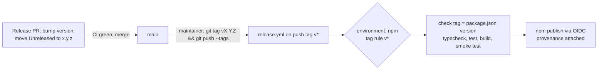

# Auto-publishing to npm from GitHub Actions

Research for [#48](https://github.com/KingsleyBawuah/clinical-faker/issues/48) (part of [#45](https://github.com/KingsleyBawuah/clinical-faker/issues/45)), feeding the "CD: automated npm publish" item in [`docs/implementation.md`](../implementation.md). The question: how should `clinical-faker` publish to npm from GitHub Actions? This covers the auth method, provenance, the release trigger, the versioning tool, `npm publish` vs `bun publish`, and the first-publish steps.

- **Sources:** primary sources only (docs.npmjs.com, docs.github.com, bun.com, and the READMEs/docs of each release tool). Every source was fetched on **2026-10-21**.
- **Repo state checked the same day:** `package.json` is at `0.1.0`, unscoped, has **no `repository` field**, and `.nvmrc` pins Node `22`. The repo is public. `main` is branch-protected with required CI checks. `CHANGELOG.md` is hand-written Keep a Changelog. `npm view clinical-faker` returns `404 Not Found`, so the name looks unclaimed.
- Anything not confirmed from a primary source is marked **inferred** or **unverified**.

## Recommendation

| Decision | Recommendation | Why (short) |
| --- | --- | --- |
| **Auth** | **npm trusted publishing (OIDC)**. No `NPM_TOKEN` secret. | npm recommends it for CI. It needs no long-lived secret. Direct publishing with granular tokens "will be removed in January 2027". |
| **Provenance** | Automatic with trusted publishing. Requires adding `repository.url` to `package.json`. | Trusted publishing on a public repo generates provenance without `--provenance`. |
| **Trigger** | **Maintainer-pushed `v*` tag** after a normal release PR, in a `release.yml` workflow gated by a GitHub `npm` environment. | Fits a single maintainer, a hand-curated Keep a Changelog file, and a protected `main` with no bot tokens. |
| **Versioning tool** | **None for now** (manual bump + changelog edit in the release PR). Revisit release-please if releases become frequent. | All three tools generate their own changelog format. release-please and changesets PRs won't run required CI under `GITHUB_TOKEN`. |
| **Publish command** | **`npm publish`** (npm ≥ 11.5.1, so use Node 24 in the publish job). Keep Bun for install/build/test. | `bun publish` "cannot generate provenance statements yet", and its docs don't mention OIDC. |
| **First publish** | Manual, local, with 2FA. Then configure the trusted publisher, then lock the package to "Require 2FA and disallow tokens". | A trusted publisher can only be configured for a package that already exists. |



## 1. Auth: trusted publishing (OIDC) vs `NPM_TOKEN`

**Trusted publishing** lets a CI workflow publish using OIDC "without the need for long-lived npm tokens" ([npm: trusted publishers](https://docs.npmjs.com/trusted-publishers)). Facts from that page:

- **Supported CI:** GitHub Actions on **GitHub-hosted runners** (also GitLab.com shared runners and CircleCI cloud). "Self-hosted runners are not currently supported".
- **Versions:** npm CLI **11.5.1+** and Node **22.14.0+**.
- **Workflow permission:** "The critical requirement is the `id-token: write` permission."
- **Config fields:** owner/repo, **workflow filename** (required, e.g. `publish.yml`), and an optional **environment name** "If using GitHub environments for deployment protection". "All fields are case-sensitive and must be exact." npm does not validate the config when you save it; mistakes only show up at publish time.
- **`repository.url` must match:** "To publish from GitHub, your package's `repository.url` field in `package.json` must exactly match your GitHub repository." **This repo has no `repository` field today, so one must be added before the first CI publish.**
- **Expiry of a new config:** "A newly created trusted publisher configuration must complete its first successful publish within 2 days."
- **Gotcha:** reusable workflows (`workflow_call`) and some `workflow_dispatch` setups can fail validation, because npm checks the *calling* workflow's filename. Keep publish in one top-level workflow file.
- **Locking down:** after setup you can choose "Require two-factor authentication and disallow tokens". Trusted publishing keeps working because "The 'disallow tokens' setting only affects traditional token authentication."

**The `NPM_TOKEN` path is closing** ([npm: about access tokens](https://docs.npmjs.com/about-access-tokens)):

- "As of November 2025, only Granular access tokens are supported. Legacy access tokens have been removed."
- "The ability to publish new package versions directly with a granular access token will be removed in **January 2027**." npm says to move automation to stage-only tokens plus [staged publishing](https://docs.npmjs.com/staged-publishing), or: "For CI/CD publishing, consider adopting trusted publishing instead."

**Conclusion:** use trusted publishing. An `NPM_TOKEN` secret would stop being able to publish directly within about three months of today.

**Optional extra gate: staged publishing.** `npm stage publish` uploads a version that only goes live after a maintainer approves it with 2FA (`npm stage approve <stage-id>` or the npmjs.com UI). It works with trusted publishing and needs npm 11.15.0+ ([npm: staged publishing](https://docs.npmjs.com/staged-publishing)). This adds a human 2FA "proof of presence" to each release. For a single maintainer who already pushes the tag by hand, the GitHub environment gate below gives similar protection with less friction. Treat staging as an optional hardening step. The `npm trust` flag `--allow-stage-publish` enables it per trusted publisher ([npm trust](https://docs.npmjs.com/cli/v11/commands/npm-trust)). Whether provenance survives staging is **unverified**: the staged-publishing page doesn't say.

## 2. Provenance

- Trusted publishing generates provenance automatically: "provenance attestations are automatically generated for your packages without requiring the `--provenance` flag" ([npm: generating provenance](https://docs.npmjs.com/generating-provenance-statements)).
- It only happens for **public** repos and packages ("Provenance generation is not supported for private repositories", [npm: trusted publishers](https://docs.npmjs.com/trusted-publishers)). This repo is public.
- `package.json` needs a public `repository` value that matches the source repo. The match is case-sensitive ([npm: generating provenance](https://docs.npmjs.com/generating-provenance-statements)). Suggested value:

  ```json
  "repository": {
  	"type": "git",
  	"url": "git+https://github.com/KingsleyBawuah/clinical-faker.git"
  }
  ```

  The `git+https://...git` form is the conventional npm shape. That npm's exact-match check accepts it is **inferred**, not stated on the page; `npm publish --dry-run` in CI won't prove it, so check the first real publish.

## 3. Trigger and versioning tool

Constraints from `AGENTS.md` and repo settings:

- `main` is protected: PRs are required (enforced for admins), CI checks are required, and force-pushes are disabled.
- `CHANGELOG.md` is hand-curated Keep a Changelog. Every user-facing PR adds an entry under `## [Unreleased]`, and "At release time, `[Unreleased]` becomes the new version section."
- Commits follow Conventional Commits (enforced by `commitlint`).

A key GitHub fact for bot-driven tools: "events triggered by the `GITHUB_TOKEN` will not create a new workflow run". The exceptions are `workflow_dispatch`/`repository_dispatch`, and PR `opened`/`synchronize`/`reopened`, which create runs "in an **approval-required** state" ([GitHub: GITHUB_TOKEN](https://docs.github.com/en/actions/concepts/security/github_token)). So a release PR opened by a bot with `GITHUB_TOKEN` won't run the required CI checks unless someone approves the run each time. The other fix is a PAT or GitHub App token.

| Option | How it works | Fit here |
| --- | --- | --- |
| **Tag push (manual)** | Maintainer opens a release PR: bumps `version`, renames `[Unreleased]` to `[x.y.z] - YYYY-MM-DD`, and adds a new empty `[Unreleased]`. After merging, they push `vX.Y.Z` from local. `on: push: tags: ["v*"]` publishes. | **Best fit.** Keeps the hand-written changelog and goes through the normal PR + CI path. A human-pushed tag triggers workflows normally (the `GITHUB_TOKEN` rule doesn't apply). No new devDependency, no PAT. Cost: version bump and changelog edit are manual (a few lines per release). |
| **release-please** ([action](https://github.com/googleapis/release-please-action), v4) | A bot keeps a release PR open, built from Conventional Commits. Merging it creates the tag and GitHub Release. Publish steps are gated on `release_created`. | Runner-up. It **writes its own changelog** (the default notes builder "Groups by commit type and links to pull requests and commits", [customizing](https://github.com/googleapis/release-please/blob/main/docs/customizing.md)), so it would replace the Keep a Changelog entries rather than read `[Unreleased]` (**inferred**: no docs mention consuming an existing section). For required CI to run on its PR, its README says to "configure a GitHub Actions secret with a Personal Access Token". Also needs "Allow GitHub Actions to create and approve pull requests" enabled. |
| **changesets** ([action](https://github.com/changesets/action)) | Each PR adds a `.changeset/*.md` file. The action opens a "Version Packages" PR that bumps versions and edits `CHANGELOG`, and publishes on merge. | Poor fit. It duplicates the existing "add a CHANGELOG entry in the PR" rule with a second mechanism and generates its own changelog sections. Same `GITHUB_TOKEN`/required-checks issue on its PR. Its README recommends using the split `version`/`publish` sub-actions with trusted publishing "to tighten publish permissions". Built for monorepos, which this isn't. |
| **semantic-release** ([npm plugin](https://github.com/semantic-release/npm)) | Computes the version from commits on every push to `main`, then tags, publishes, and creates a GitHub Release. Supports trusted publishing (`id-token: write`, provenance automatic). | Poor fit. Fully automatic releases on every merge take away "when to release" control. Writing the version and changelog back to `main` (via `@semantic-release/git`) conflicts with branch protection that's enforced for admins (**inferred**). Without it, `package.json` and `CHANGELOG.md` in git never show the released version. |

**Recommendation:** tag push now. If release cadence grows, release-please is the most natural upgrade, because the repo already enforces Conventional Commits. That upgrade means giving up the hand-written changelog format and adding a GitHub App/PAT token, so it's a separate decision.

**Hardening the tag trigger** (GitHub settings, no code):

- Create a GitHub **environment** `npm` with deployment rule **Selected branches and tags → Tag `v*`**. Optionally add yourself as a required reviewer for a one-click "approve publish" gate (self-approval is allowed unless "Prevent self-review" is set). Environments are available on Free plans for public repos ([GitHub: manage environments](https://docs.github.com/en/actions/how-tos/deploy/configure-and-manage-deployments/manage-environments)). Enter the same environment name in the npm trusted-publisher config, so only jobs in that environment can publish.
- Optionally add a **tag ruleset** restricting who can create `v*` tags (**unverified** detail; not fetched for this note).
- The workflow should fail if the tag doesn't equal `v${package.json version}`, and re-run typecheck/test/build/smoke-test before publishing.

## 4. `npm publish` vs `bun publish`

- **`bun publish`:** "`bun publish` cannot generate provenance statements yet". Passing `--provenance`, or setting `publishConfig.provenance` / `NPM_CONFIG_PROVENANCE=true`, is an error. Auth is via `NPM_CONFIG_TOKEN` or `.npmrc`. The docs don't mention OIDC or trusted publishing ([Bun: publish](https://bun.com/docs/pm/cli/publish)). So it can't do the recommended auth or provenance.
- **`npm publish`:** supports trusted publishing and automatic provenance. It needs npm ≥ 11.5.1. Node 22's bundled npm is 10.9.9, while Node 24.22.1 bundles npm 11.19.1 ([nodejs.org dist index](https://nodejs.org/dist/index.json)). So the publish job should use `actions/setup-node` with Node **24** (or run `npm install -g npm@latest` on 22). `.nvmrc` (22) stays as-is for the engines floor and smoke test.
- **The `exports` map doesn't affect the choice.** `files: ["dist"]` decides what's in the tarball, and `exports` points into `dist`. Both tools pack the same files; Bun's extra rewriting only touches `workspace:`/`catalog:` protocols, which this repo doesn't use (**inferred**). Verify once with `npm pack --dry-run` before the first publish.
- Unscoped packages are always public, so `--access public` is a no-op here (kept harmless in the first-publish command).

### Workflow sketch (for the implementation ticket; not run)

```yaml
name: Release

on:
  push:
    tags: ["v*"]

permissions:
  contents: read

jobs:
  publish:
    runs-on: ubuntu-latest   # GitHub-hosted runner required for trusted publishing
    environment: npm         # must match the npm trusted-publisher config
    permissions:
      contents: read
      id-token: write        # OIDC token for npm
    steps:
      - uses: actions/checkout@v7
      - uses: oven-sh/setup-bun@v2
        with:
          bun-version: "1.4.0"
      - uses: actions/setup-node@v7
        with:
          node-version: "24"   # bundles npm >= 11.5.1
          package-manager-cache: false
      - run: bun install --frozen-lockfile
      - name: Tag must match package.json version
        run: test "v$(node -p 'require("./package.json").version')" = "$GITHUB_REF_NAME"
      - run: bun run typecheck
      - run: bun test
      - run: bun run build
      - run: node scripts/smoke-test-esm.mjs
      - run: npm publish
```

## 5. First-publish steps

npm cannot configure a trusted publisher for a package that doesn't exist yet: "The package you're configuring must already exist on the npm registry" ([npm trust](https://docs.npmjs.com/cli/v11/commands/npm-trust)). So the first version goes out by hand.

1. **Account + 2FA:** create or sign in to the npm account and enable 2FA. `npm trust` requires it: "Even if it's not currently enabled, you must enable it to use trust commands" ([npm trust](https://docs.npmjs.com/cli/v11/commands/npm-trust)).
2. **Check the name:** `npm view clinical-faker` → 404 as of 2026-10-21. Re-check right before publishing.
3. **Release PR for `0.1.0`:** add `repository` to `package.json` and move `[Unreleased]` to `[0.1.0]`. Merge it **without** `release.yml`. A tag only runs the workflow file present at the tagged commit, so tagging `v0.1.0` here won't trigger a publish that would collide with the manual one (**inferred** from how `on: push: tags` reads the workflow from the pushed ref).
4. **Publish locally** from a clean checkout of `main`: `bun install --frozen-lockfile && bun run build && npm pack --dry-run`, then `npm publish --access public` and answer the 2FA prompt. Tag the commit `v0.1.0` and push the tag. **Trade-off:** this first version has **no provenance**. To get provenance on `0.1.0` too, publish a throwaway `0.0.0` placeholder by hand first, let CI publish `0.1.0`, then `npm deprecate clinical-faker@0.0.0 "placeholder"`. Simpler path recommended: accept no provenance on `0.1.0`.
5. **Configure the trusted publisher** (then push the next tag within 2 days, since a new config expires if it has no successful publish by then): use npmjs.com → package → Settings → Trusted publishing, or `npm trust github clinical-faker --file release.yml --repo KingsleyBawuah/clinical-faker --env npm --allow-publish` (needs npm ≥ 11.15.0 locally; local npm today is 11.11.0, so upgrade or use the website). Only one trusted-publisher config is allowed per package.
6. **Lock down:** package → Settings → Publishing access → "Require two-factor authentication and disallow tokens". Trusted publishing still works.
7. **Create the GitHub `npm` environment** (tag rule `v*`, optional required reviewer), and merge the PR adding `.github/workflows/release.yml`. Do this before step 5's 2-day window runs out.
8. **Next release:** release PR → merge → `git tag v0.1.1 && git push origin v0.1.1` → check the npm page shows the provenance badge.

## Open items / unverified

- Whether npm's exact `repository.url` match accepts the `git+https://github.com/<owner>/<repo>.git` form: **inferred** yes; confirm on the first CI publish.
- Tag ruleset details for restricting `v*` creation: not fetched.
- Whether provenance survives staged publishing: not stated by npm.
- release-please consuming an existing Keep a Changelog `[Unreleased]` section: no evidence it does (**inferred** no).

## Sources

- npm, Trusted publishing for npm packages (page "Last edited … October 6, 2026"): <https://docs.npmjs.com/trusted-publishers>
- npm, Generating provenance statements: <https://docs.npmjs.com/generating-provenance-statements>
- npm, About access tokens: <https://docs.npmjs.com/about-access-tokens>
- npm, Staged publishing: <https://docs.npmjs.com/staged-publishing>
- npm CLI v11, `npm trust`: <https://docs.npmjs.com/cli/v11/commands/npm-trust>
- npm, Requiring 2FA for package publishing and settings modification: <https://docs.npmjs.com/requiring-2fa-for-package-publishing-and-settings-modification>
- GitHub, `GITHUB_TOKEN`: <https://docs.github.com/en/actions/concepts/security/github_token>
- GitHub, Managing environments for deployment: <https://docs.github.com/en/actions/how-tos/deploy/configure-and-manage-deployments/manage-environments>
- Bun, `bun publish`: <https://bun.com/docs/pm/cli/publish>
- Node.js release index (bundled npm versions): <https://nodejs.org/dist/index.json>
- release-please-action README: <https://github.com/googleapis/release-please-action>
- release-please customizing docs: <https://github.com/googleapis/release-please/blob/main/docs/customizing.md>
- changesets/action README: <https://github.com/changesets/action>
- semantic-release/npm README: <https://github.com/semantic-release/npm>
